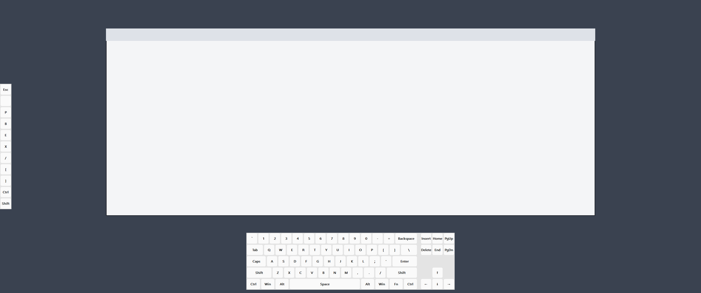

# EdgePad

[English](README.md) | 日本語

画面の上下左右の端に、タッチとマウスで押せるキーを並べる、Windows の常駐ソフトです。指で Ctrl を押さえたまま（または、タップでラッチして）ペンで描くと、前面のアプリ（CLIP STUDIO PAINT など）にはキーボードとペンの操作として届きます。



- 単体の exe 1 つで動きます（インストール不要、1 MiB 以下）
- キーは押している間だけ押す、離した時に 1 回送る、くり返す、マクロ、文字の入力、プログラムを開く、パイメニュー、レイヤーなどを選べます
- 前面のアプリに合わせて、辺ごとのキーを自動で切り替えます
- Keyboard Layout Editor（KLE）で組んだ配列を、そのまま並べられます
- 設定はテキストの設定ファイル 1 つで、トレイから開く設定画面でもすべて編集できます

## 動作環境

- Windows 10 21H2 以降、Windows 11（x64）
- 実機で確かめたのは Windows 11 だけです。Windows 10 21H2 は、使っている仕組み（WM_POINTER、Per-Monitor DPI V2 など）がそろう下限として挙げています

## 入れ方

1. [Releases](https://github.com/marby3/EdgePad/releases) から `EdgePad-vX.Y.Z-windows-x64.zip` をダウンロードし、好きなフォルダに展開します。
2. `edgepad.exe` を起動します。タスクバーの通知領域（トレイ）に EdgePad のアイコンが出ます。
3. やめる時は、トレイのアイコンを右クリックして「終了」を選びます。

設定ファイル `edgepad.ini` は、exe と同じフォルダにあるものを先に読みます。なければ `%APPDATA%\EdgePad\edgepad.ini` を読みます。exe のフォルダに書き込めない場所（Program Files など）に置く時は、設定ファイルを `%APPDATA%\EdgePad` に置いてください。

Windows の起動時に動かすには、トレイのメニューの「Windows起動時に自動起動」を選びます。

## 同梱の設定

zip には、すぐに使える設定が入っています。

- 左辺: CLIP STUDIO PAINT 向けのキーです。上から Esc、空き、P、B、E、X、/、[ と ]（ブラシの大きさ。押している間くり返す）、Ctrl、Shift です。P などは CLIP STUDIO PAINT の既定のショートカットのキーで、押すとそのキーを送ります。
- 下の辺: US 配列のキーボードです。起動した時は隠れていて、画面の下の細い帯（ハンドル）をタップするか、上へスワイプすると出ます。Fn を押している間は、数字の段が F1〜F12 になります。
- ほかに、左右分割 42 キー、Corne V4 46 キー、キーを回した 64 キーのキーボードも入っています。設定画面の「アプリ別」で、下の辺に選べます。

## 使い方

- パネルの上で端の方へスワイプすると、パネルを隠します。ハンドルをタップするか、ハンドルから内側へスワイプすると、また出ます。
- 修飾キー（Ctrl、Shift など）を短くタップすると、ラッチ（押したまま）になります。もう一度タップすると解けます。
- トレイのメニューから、辺ごとの表示の切り替え、一時停止、押しているキーの全解放、設定の読み直しができます。

## 設定画面

トレイのメニューの「設定…」で開きます。左のサイドバーで画面を選びます。

| 画面 | 変えられること |
|---|---|
| キー配置 | キーセットと、パネルの形（キーの数、並び、幅、位置）。KLE のファイルの読み込み |
| キーマッピング | 各キーが何を送るか。キーボードの絵から選ぶほか、レイヤー、マクロ、文字・起動、ページ・パイ |
| アプリ別 | プロファイル（どのアプリの時に、どの辺にどのキーセットを出すか） |
| 辺（共通） | 全部の辺に共通の設定 |
| 辺ごとの設定 | 辺ごとの表示、ドック、画面の端からの距離、起動した時に出すか、モニター、列数・行数、ハンドル |
| 見た目 | キーの大きさ、不透明度、テーマ、アクセント色 |
| タッチと修飾キー | ラッチになる長さ、ラッチの解け方、ペンでキーを押すか |
| 表示と非表示 | ホットキー、ハンドルに乗せて出すまでの時間、自動で隠すまでの時間 |

「保存」で設定ファイルに書き、EdgePad がすぐに読み直します。設定ファイルの書き方は、[設定リファレンス](docs/reference.ja.md)にまとめてあります。

## 管理者権限で動くアプリには送れません

Windows の仕組み（UIPI）のため、ふつうの権限で動く EdgePad からは、管理者権限で動くアプリへキーを送れません。そうしたアプリで使う時は、EdgePad も管理者として実行してください。送れなかった時は、トレイの通知で知らせます。

## F13〜F24 の使い方

ふつうのキーボードにない F13〜F24 を送れます。アプリのショートカットの設定で、使いたい機能に F13 などを割り当て、EdgePad のキーに `F13` を送らせると、ほかのショートカットとぶつかりません。

```ini
key = 左右反転 | shortcut | F13   ; CLIP STUDIO PAINT 側で F13 を「左右反転」に割り当てる
```

## ライセンスと署名

- ライセンスは [MIT License](LICENSE) です。
- exe の署名: Free code signing provided by SignPath.io, certificate by SignPath Foundation（[Code signing policy](docs/code-signing-policy.md)）
